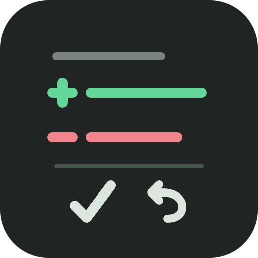
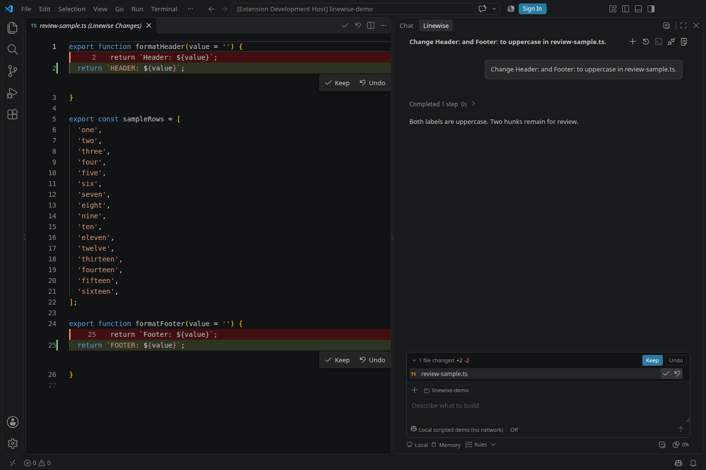
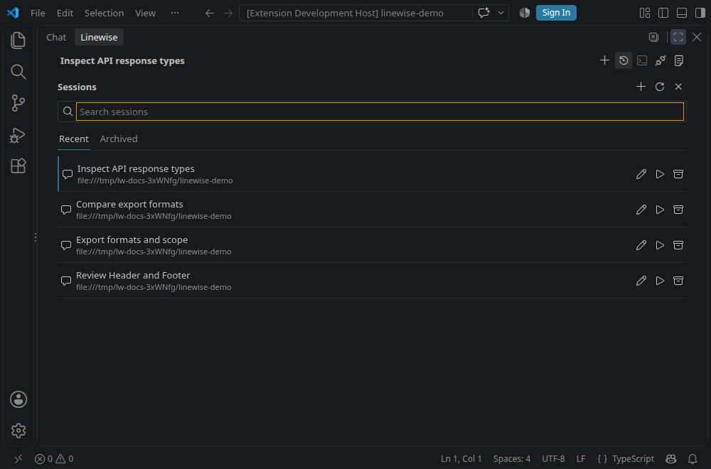
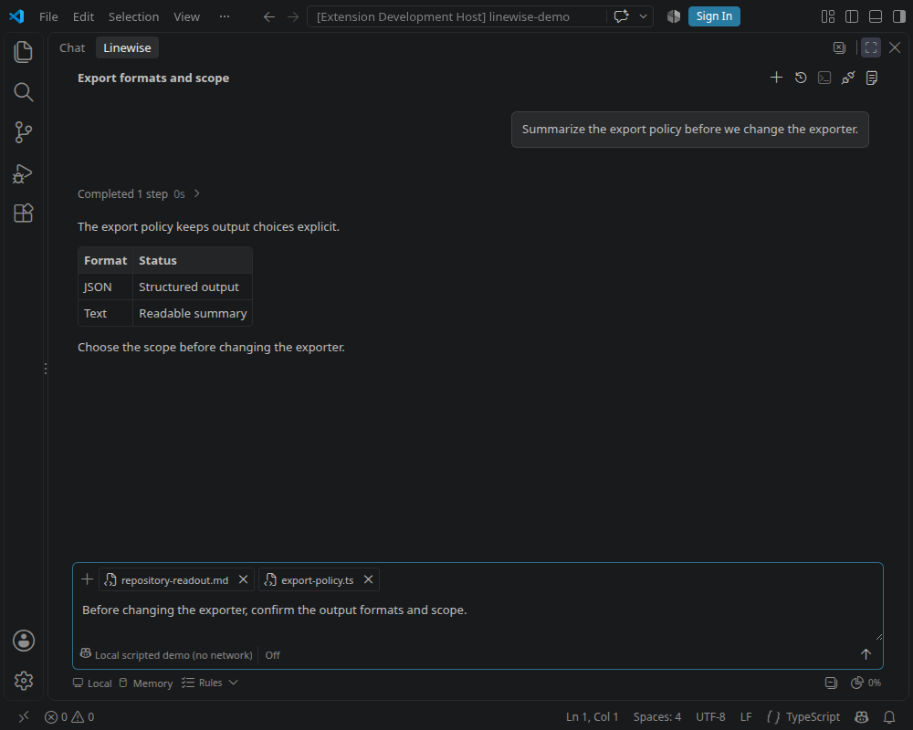
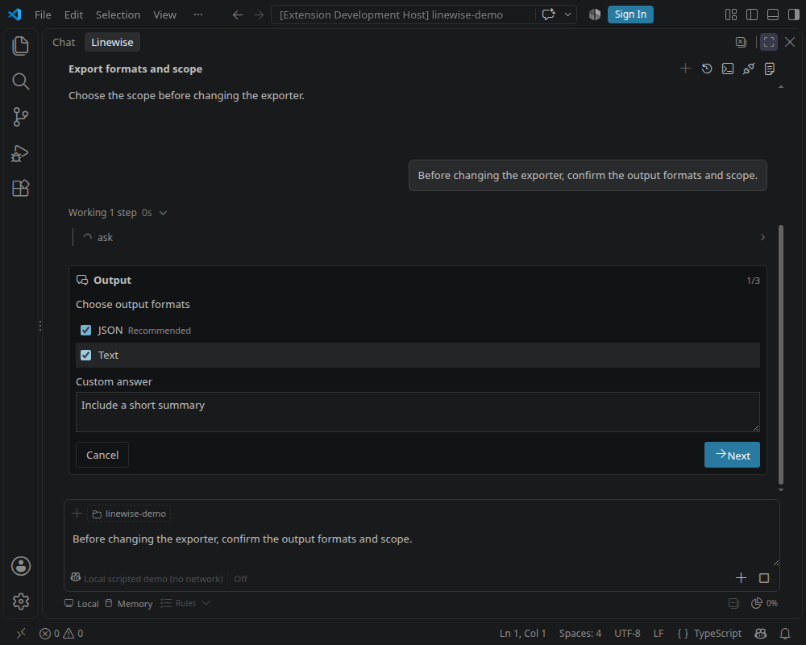
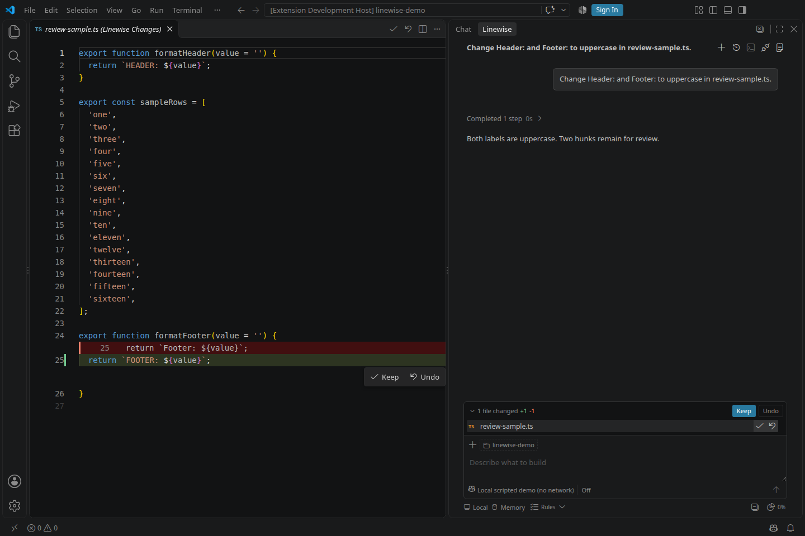

<!-- markdownlint-configure-file { "MD033": { "allowed_elements": ["h1", "h3", "p", "b", "br", "a", "img", "sub", "table", "tr", "td"] } } -->

<!-- markdownlint-disable-next-line MD041 -->
<p align="center">
   
</p>

<h1 align="center">Linewise</h1>

<p align="center">
   <b>Open agent coding. Granular review. Inside VS Code.</b><br>
   Powered by <a href="https://github.com/can1357/oh-my-pi">Oh My Pi</a> and hopefully many other harnesses soon.
</p>

<p align="center">
   <a href="#try-it"><b>Try v0.1.7</b></a> &middot;
   <a href="docs/comparison.md">See the review flow</a> &middot;
   <a href="TODO.md">Find a task</a> &middot;
   <a href="https://github.com/qu-gg/linewise/discussions">Join the discussion</a>
</p>

<p align="center">
   <a href="LICENSE">MIT licensed</a> &middot;
   Public VS Code APIs + ACP &middot;
   v0.1.7 &middot; Linux x64 preview
</p>

Linewise brings an open coding-agent harness into your editor, with a familiar chat experience inspired by VS Code's Local Harness. Manage sessions, attach chosen context, answer structured questions, inspect agent activity, and control command permissions alongside your code. Review text edits hunk by hunk and whole-file operations individually, keep the changes you want, and undo the ones you do not.

It is an independent alternative for people who value VS Code's Local chat workflow. Oh My Pi owns the agent loop; Linewise owns the editor experience, approvals, and review. It uses public VS Code APIs and ACP, not private Copilot services. It remains dependent on supported VS Code APIs and versions, but not on Copilot's harness release cycle.

<!-- prettier-ignore-start -->

<!-- markdownlint-disable-next-line MD009 MD022 -->
### **But why? Just use X or Y instead, "IDEs are things of the past."** 
I have been hearing this notion that "IDEs no longer have use" and we should just accept interfacing with agents via sterilized chat windows where you have little control or understanding of your actual file structure. I am quite opininated on this and reject that notion for specific workflows or granularity of work. There is immense value (to me and I suspect many others) in seeing and deciding agent changes line-by-line, in quickly making sure that hyperparameters of an expensive synthetic data run are unchanged or that some misaligned addition is caught. Working intentionally and iteratively with an agent can be needed at times.

Of all the harnesses/agent experiences I have tried, the Local Harness in VSCode has been by far the best. I love having the familiar deeply-integrated workspace, knowing and partitioning the file structure of different projects across different workspaces, and having memory files on device that isn't reliant on the cloud. So given that Copilot has decided to rugpull the Local Harness away in favor of their cloud Copilot Chat (WITHOUT feature parity!), I've decided to make my attempt at an alternative: **Linewise**. It breaks free from relying on a company that deprecates products on a whim while hopefully providing a similar - if not even more customizable - experience.

**Linewise** is not *quite* there yet but it is getting closer and closer! I hope my feelings resonate with some and we can build something great. I understand the potential hypocrisy of building this project largely via long-running agents, which might seem very much against the spirit of granularity that I just soapboxed about. But hey, I did specify this is for specific workflows :)

<!-- prettier-ignore-end -->

> [!IMPORTANT]
> **v0.1.7 is an early preview.** Contributors and careful testers are welcome. Start with a disposable workspace. Accepted VSIX downloads and checksums are listed on [GitHub Releases](https://github.com/qu-gg/linewise/releases); a source version alone is not a published release. There is no Marketplace listing.

<p align="center">
   <a href="docs/comparison.md">
      
   </a><br>
   <sub>Full-file review beside chat, with room for both. All screenshots below use actual native controls, synthetic workspaces, and scripted agent replies, not live model results.</sub>
</p>

<p align="center">
   <a href="#why-linewise">Highlights</a> &middot;
   <a href="#a-familiar-agent-workflow">Chat workflow</a> &middot;
   <a href="#keep-what-you-want">Selective review</a> &middot;
   <a href="#try-it">Try it</a> &middot;
   <a href="#control-and-limits">Boundaries</a> &middot;
   <a href="#build-with-us">Contribute</a> &middot;
   <a href="#license-and-credits">Credits</a>
</p>

---

## Why Linewise

<table>
   <tr>
      <td width="33%" valign="top">
         <h3>Your editor</h3>
         <p>Chat beside your code, attach context, inspect tool activity, and open related diagnostics and tasks.</p>
      </td>
      <td width="33%" valign="top">
         <h3>Your changes</h3>
         <p>Review the full file with floating hunk-level Keep/Undo. Keep one change without accepting the next.</p>
      </td>
      <td width="33%" valign="top">
         <h3>Open harness</h3>
         <p>OMP runs the agent loop. Linewise owns the editor workflow and approvals without waiting for Copilot's harness releases.</p>
      </td>
   </tr>
</table>

Model access uses whichever providers you have authenticated in OMP. Linewise shows OMP's advertised model catalog and does not store credentials. For new chats on OpenRouter models, it may fetch OpenRouter's public endpoint catalog (model identifier only; no credentials or conversation content) to offer an upstream **Route** picker that defaults to Auto. Open-source harness infrastructure does not mean free inference, support for every OMP provider, or independence from provider policies.

## A Familiar Agent Workflow

Selective review is one part of the experience. Linewise also brings the everyday conversation controls that make an editor-integrated agent useful. These are Local Harness-inspired workflows, not a claim of complete Local/Copilot parity; the [capability matrix](PARITY.md) records the exact boundaries.

### Sessions You Can Return To

Search and filter sessions grouped by recency (`Today`, `Yesterday`, `Last 7 days`, `Older`), with relative activity, pending-review line totals, and a reversible Archived group. At panel widths of about 620 px or more the picker sits beside the conversation as a collapsible sidebar and remembers that state; narrower panels open it full-surface. Rename conversations, archive and restore them, and explicitly resume where you left off. Open a transcript without starting the agent. Edit and Continue and before/after forks let you branch a conversation without rewriting its original history.

<p align="center">
   <a href="docs/images/linewise-sessions.png"></a><br>
   <sub>Actual session records and native controls. Conversation branches do not roll back workspace files, pending review, or shared memory.</sub>
</p>

### Context You Choose

Attach an editor or selection, multiple files, images, chosen open resources, or workspace problems. Paste a PNG, JPEG or WebP image from the clipboard directly into the composer to attach it, with optional pasted text preserved in the draft. Inspect and remove attachment chips before sending. Submitted context is an immutable snapshot stored with that turn, not a later reread of a changed file; unrelated tabs are not silently attached.

<p align="center">
   <a href="docs/images/linewise-context.png"></a><br>
   <sub>Two explicitly attached files in the composer. This capture verified their actual submitted snapshot contents.</sub>
</p>

### Questions Before Decisions

Answer bounded single-choice, multiple-choice, and free-text questions directly in chat. Step through the questions, review the combined answers, then Submit or Cancel. Questions collect your input; they do not supply credentials or grant command approval.

<p align="center">
   <a href="docs/images/linewise-questions.png"></a><br>
   <sub>Native choices and free-text input. The scripted flow checked all three submitted answers against the OMP tool result.</sub>
</p>

### Permissions You Can See

Open the permission menu beside Memory to choose **Command Rules**, **Ask Every Time**, or separately confirmed **Allow All Except Restrictions** and **YOLO Commands** without leaving the chat. Elevated modes show their warning and explicit Enable step inside the same panel. The selected mode lasts for the workbench window and is inherited by new chats; elevated modes reset on extension reload, workspace trust change, or explicit edit/fork history rollback, while reconnect and same-session retry preserve the current mode. Commands use your host permissions, not an OS sandbox; outside-workspace file access and web/browser consent remain independent.

### Activity, Plans, And Follow-Ups

Follow streamed replies with collapsible activity, thinking, and tool records, separate final answers, and the agent's structured Todos. Model/thinking controls, a new-chat OpenRouter route picker, and provider-reported context usage stay close to the composer; Linewise does not invent reasoning or billing figures.

Keep per-session drafts and queue follow-up prompts while work is running. Queued prompts run in order after cleanup, pause on failure, and clear on Stop or ownership changes; they are not in-flight steering or Autopilot. Local memory, owned terminal/browser controls, and approved editor/task integrations round out the workflow. See [usage](docs/usage.md) for the details and limits.

## Keep What You Want

Keep the Header hunk, then undo Footer. The accepted `HEADER:` remains while the pending change returns to `Footer:`. No extra model request is needed to make that review decision.

<p align="center">
   <a href="docs/comparison.md#undo-footer">
      
   </a><br>
   <sub>Keep Header. Footer stays pending. Undo Footer without losing the accepted Header; see the final editor state in the comparison.</sub>
</p>

These are actual native controls exercised with synthetic file-tool changes. The [comparison page](docs/comparison.md) includes matched Linewise/Local transcript views, exact evidence limits, and image provenance. Creation, deletion, and moves use whole-operation review; arbitrary individual-line acceptance is not implemented.

---

## Try It

The v0.1.7 acceptance profile is **Linux x64, VS Code 1.147.0, OMP 19.2.1, and a trusted single-root local filesystem workspace**. Other platforms, Remote-SSH, multi-root lifecycle, and untrusted/virtual workspaces are not certified.

The VSIX's `linux-x64` target is not just a filename: it includes a matching native terminal dependency and currently Linux-only host behavior. Other compatible Linux distributions may work, but macOS, Windows, and ARM64 are not automatically supported. Help test or port a named target through the [platform compatibility workstream](TODO.md#platform-compatibility).

1. Install [Oh My Pi](https://github.com/can1357/oh-my-pi) separately. `omp --version` must report `omp/19.2.1` or a newer 19.x release. Run `omp` and use its `/login` flow if your selected provider needs authentication; Linewise does not copy VS Code's Copilot credentials.
2. Go to [GitHub Releases](https://github.com/qu-gg/linewise/releases), download the Linux x64 VSIX from [v0.1.7](https://github.com/qu-gg/linewise/releases/tag/v0.1.7), and verify it against the accompanying `SHA256SUMS`. Alternatively, build a development VSIX with **Node 24.11+**:

   ```sh
   git clone https://github.com/qu-gg/linewise.git
   cd linewise
   npm ci
   npm run check
   npm run build
   npm run package -- --target linux-x64 --out linewise-dev-linux-x64.vsix
   ```

3. Use **Extensions: Install from VSIX**, then open a disposable workspace and run **Linewise: Open Chat**.
4. Set `omp.executablePath` in user settings if OMP is not on PATH. Choose a model, attach context explicitly, and send a prompt.
5. Select a changed file, then Keep or Undo individual pending hunks. Creation, deletion, and moves use whole-operation review.

The extension ID remains `vs-omp-local.vs-omp`, and settings/command IDs retain their `omp.*` namespace for compatibility. A development package is not an accepted release candidate. See [development](docs/development.md) and [release policy](RELEASE.md).

## Control And Limits

Review is independent of Git. Pending edits accumulate across prompts; conflicts refuse to overwrite newer user or external changes. Keep/Undo covers journaled file-tool changes, **not shell side effects or conversation history**.

Commands run with your host permissions, **not in an OS sandbox**. Command Rules is the default; Ask, window-scoped Allow All, and explicitly confirmed YOLO are available. YOLO's static denylist is best effort, not a destruction detector. File-tool outside-workspace approval and URL/browser consent remain separate.

Prompts, attached context, approved reads, and tool results can reach your selected model provider. Local transcripts, snapshots, and memory can contain sensitive code; private filesystem modes are not encryption. There is no extension telemetry. Read the [security and privacy policy](SECURITY.md) before using sensitive projects.

## Build With Us

We want contributors who care about agent workflows **and** the ability to inspect, interrupt, and selectively accept their work. Useful starting points include fresh-user onboarding, accessibility, reproducible visual tests, provider compatibility, and platform acceptance.

- [Contributing](CONTRIBUTING.md): setup, small pull requests, tests, and evidence.
- [Roadmap](ROADMAP.md): priorities and dependencies.
- [Shared task ledger](TODO.md): stable IDs, atomic changes, verification work, and how to claim a task.
- [Platform compatibility](TODO.md#platform-compatibility): additional Linux distro testing, ARM64 builds, and macOS/Windows portability with target-specific acceptance.
- [Capability matrix](PARITY.md): what works, what is partial, and what is unavailable.
- [Issues](https://github.com/qu-gg/linewise/issues): bugs and concrete proposals.
- [Discussions](https://github.com/qu-gg/linewise/discussions): questions and design conversations.

Large changes to permission boundaries, storage, runtime integration, or supported hosts should begin with an issue or discussion. We welcome AI-assisted contributions; contributors remain responsible for understanding, provenance, and verification.

Broader platform support, Remote-SSH, model providers, and alternate open harnesses are explicit workstreams in the shared ledger, not current support claims. A small, well-tested compatibility slice is useful progress; it need not solve the entire workstream.

## License And Credits

Project-owned code is [MIT licensed](LICENSE). [Attribution](ATTRIBUTION.md) identifies upstream projects and the distinction between inspiration and integration. Bundled components retain their [third-party licenses](THIRD_PARTY_NOTICES.txt).

Linewise is independent of Microsoft, GitHub, and Oh My Pi's maintainers. Comparison does not imply endorsement or complete Local/Copilot parity.
