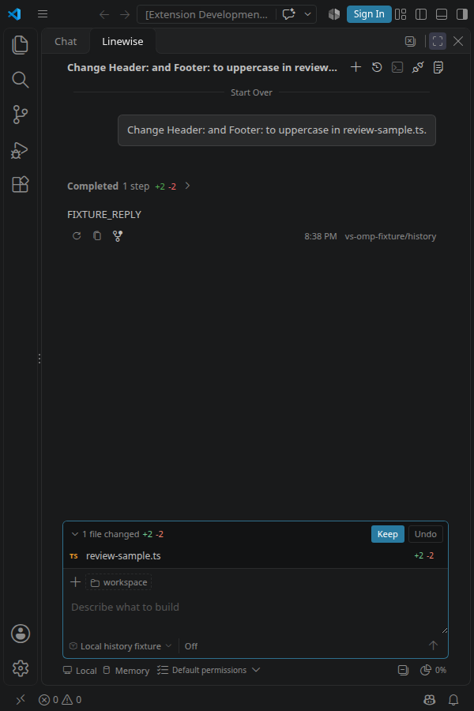
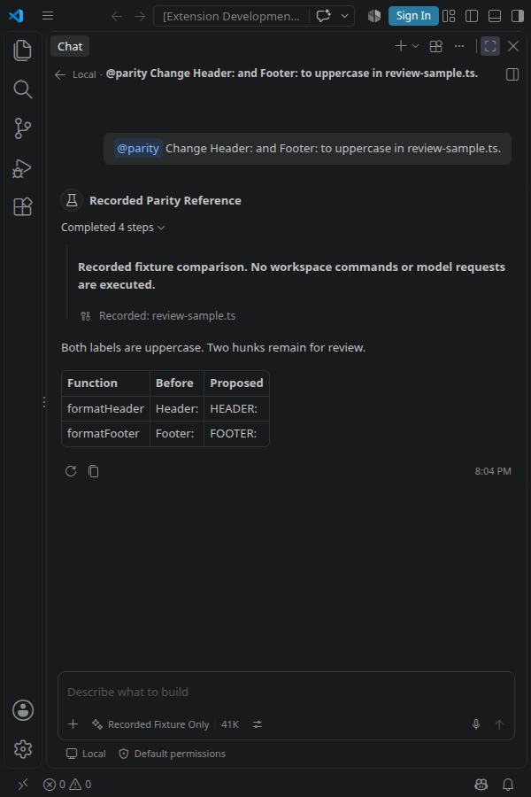
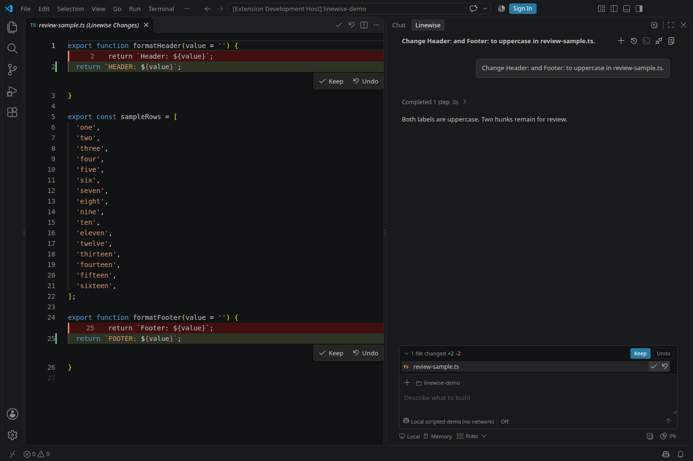
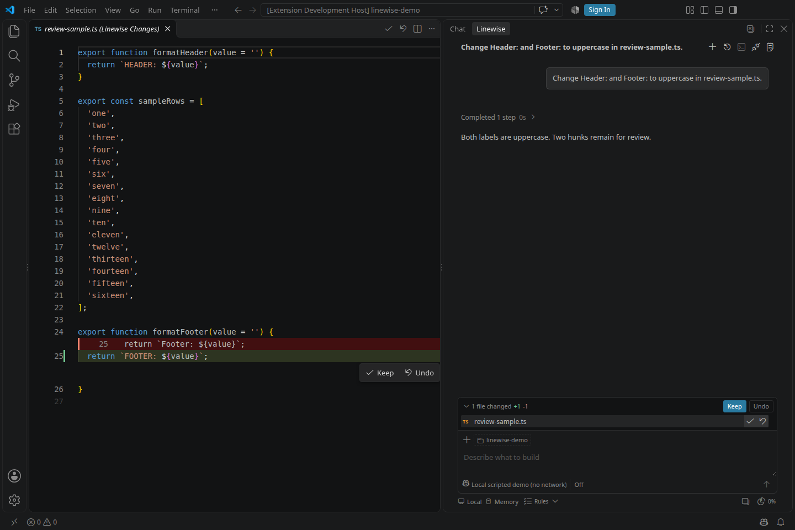
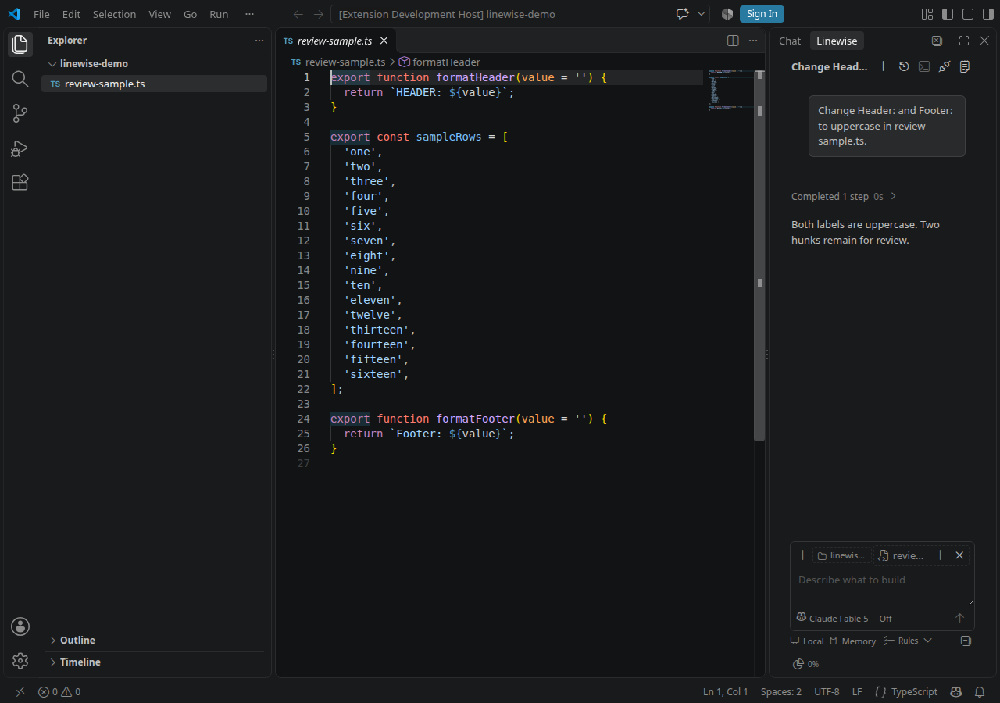

# Linewise And Local

Linewise aims for a familiar IDE workflow with an independently maintained agent loop and selective review. These screenshots compare presentation, not model quality or complete functional parity. They were captured from real VS Code workbenches, not painted mockups.

The shared synthetic task is: **Change Header: and Footer: to uppercase in review-sample.ts.** No private project, account, credentials, or real model generation was used.

## Matched Transcript Views

Both views use VS Code 1.146.0 on Linux x64, the Dark 2026 theme, zoom 0, and a maximized secondary sidebar at 600 x 900 pixels. The prompt and final answer are shared; tool records and available controls intentionally differ.

### Linewise

A guarded scripted OMP provider runs the fixture. The fixture really changes the disposable file through Linewise's file-tool/review path. The displayed model name is fixture presentation, not a claim that that model generated this reply. The summary offers review actions for the actual pending changes.

### VS Code Local Reference

The native Local workbench uses a recorded-only participant and model that refuses generation. Its table and tool record are synthetic transcript content; it does not edit a file or demonstrate Local's native edit-review controls. This is a visual transcript reference, not authenticated Local agent execution, performance evidence, or an editing-parity test.

## Selective Hunk Review

The editor views use 1440 x 960 pixels with the same theme and zoom. The primary sidebar is hidden and chat occupies about 640 pixels, leaving room to read both the file and conversation. Linewise's custom review editor is read-only; floating controls decide individual pending hunks rather than arbitrary individual lines.

### Two Pending Hunks

Both labels have been changed on disk. The review shows the original and proposed text in the full-file context.

### Keep Header

Keeping the first hunk advances its accepted baseline. The Footer change remains pending, with its own Keep/Undo controls.

### Undo Footer

Undo restores `Footer:` without losing the accepted `HEADER:` edit. The pending review closes, and the ordinary editor shows the final file. The capture checked exact final bytes and unchanged provider context during review controls; those controls did not request another generation.

## Beyond Review

The [README workflow gallery](../README.md#a-familiar-agent-workflow) also shows session management, explicit file attachments, and in-chat questions. Context and question views use 1000 x 800 pixels; session views use 1000 x 660 pixels with the chat sidebar maximized. These are native controls with synthetic records and a guarded scripted provider, not painted mockups.

The feature capture verified submitted attachment snapshots, all three question answers, and session search and archive/restore. A separate native acceptance run confirmed that the inline permission menu enables and then restores Allow All and YOLO while preserving ask exceptions. Unrelated workflows in the capability matrix remain separately governed. Review and feature checks have separate evidence scopes; no complete Local parity or new release acceptance is implied.

## Provenance And Limits

All eight PNGs are unaltered Playwright screenshots of disposable native extension-development workbenches. There is no cropping, compositing, pixel replacement, or metadata redaction. Routine notifications were dismissed or disabled in those documentation profiles; synthetic handshake files were hidden from Explorer. The normal profile and native notification/privacy tests were not changed.

The images contain only PNG image chunks, with no text or EXIF metadata. Their dimensions, SHA-256 hashes, capture environment, and evidence level are recorded in [the image ledger](images/provenance.json) and checked by `npm run check:public`. Project-written fixture code/text is MIT licensed; visible upstream workbench/interface elements retain their respective rights and do not imply endorsement. See [attribution](../ATTRIBUTION.md).

These captures demonstrate the current review flow, transcript layout, and the named feature controls. They do not certify other platforms, narrow/mobile extension layouts, accessibility, provider compatibility, Local editing equivalence, or release acceptance. The [capability matrix](../PARITY.md) and [release policy](../RELEASE.md) remain authoritative about supported scope.
